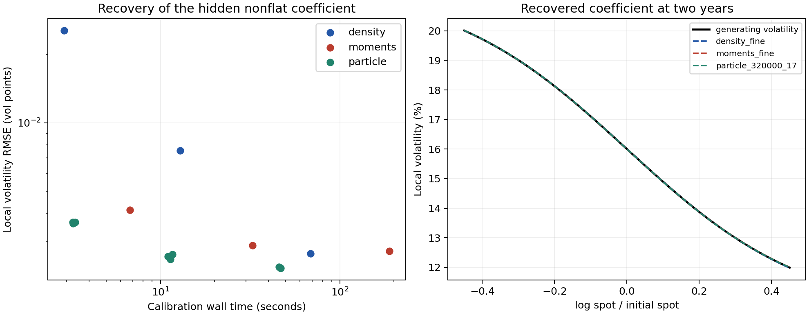

# Nonflat synthetic calibration: completed numerical study

Date: 2026-11-14 UTC. Based on locally merged commit `a379536`, including remote
`main` through `ce1e95d`. The code and results here are subsequent additions.
No real-market data are used.

## Findings

All 15 calibrations have completed. Each recovers a coefficient from the same
synthetic Dupire-variance table without receiving the generating volatility.
All 15 frozen surfaces have then been repriced on an independent Monte Carlo
sample against the generating three-factor model.

On matching grids the density solver is 2.3–2.8 times faster than the five-field
solver. The five-field method has materially smaller recovery and repricing
errors on the coarse grid. At the finest grids, recovery errors are similar,
while the density method has the smaller maximum repricing error. The particle
implementation gives the best observed runtime–accuracy tradeoff here.

These findings concern this test and these implementations. They do not
establish a general performance advantage, a convergence rate, or existence
for the nonlinear calibration equation.

## Measurements

Errors are **volatility percentage points**: 0.01 means one volatility basis
point, or 0.0001 in decimal volatility. Repricing errors are price differences
scaled by a reference Black vega and multiplied by 100, not differences of
inverted implied volatilities. Particle rows average runtime and recovery RMSE
across three seeds and show the worst maximum repricing error across seeds.

| Method | Grid / particles | Calibration seconds | Local-vol RMSE | Maximum repricing error |
| --- | --- | ---: | ---: | ---: |
| Density | 61 × 31 × 31 | 2.91 | 0.02552 | 0.02844 |
| Five fields | 61 × 31 × 31 | 6.75 | 0.00414 | 0.00644 |
| Density | 101 × 51 × 51 | 12.88 | 0.00755 | 0.00815 |
| Five fields | 101 × 51 × 51 | 32.58 | 0.00289 | 0.00415 |
| Density | 141 × 71 × 71 | 68.83 | 0.00266 | 0.00229 |
| Five fields | 141 × 71 × 71 | 189.40 | 0.00273 | 0.00395 |
| Particle | 20,000; 3 seeds | 3.28 | 0.00364 | 0.00389 |
| Particle | 80,000; 3 seeds | 11.36 | 0.00258 | 0.00263 |
| Particle | 320,000; 3 seeds | 46.45 | 0.00231 | 0.00215 |

Every run, including maximum coefficient errors, mean absolute pricing errors
and standard errors, is retained in [comparison.csv](results/comparison.csv).
The 320 rows in [repricing.csv](results/repricing.csv) cover 15 calibrated models
plus the generating model at 20 option points each.



## Common model and target

Initial spot is 1 and the horizon is two years. Initial flat domestic and
foreign forward curves are 2.5% and 1.5%. Hull–White parameters are
`kd=0.07, kf=0.13, sd=0.02, sf=0.025`; correlations are
`rho_Sd=0.25, rho_Sf=-0.20, rho_df=0.15`.

Writing `x=log(S/S0)`, the generating coefficient is

```text
level(t) = 0.16 [1 + 0.08 sin(pi t / 2)]
skew(t)  = 0.35 + 0.04 sin(pi t / 2)
sigma_true(t,x) = level(t) [1 - skew(t) tanh(2x)]
```

Both level and skew vary with time. Spatial nonconstancy activates the
volatility derivative and the shared-noise moment fluxes.

The reference discounted physical density is computed on a 201 × 101 × 101
grid with time step 0.002. The common target variance is formed as
`sigma_true^2 + rate_tail_correction` from that density. This evaluates the
continuous calibration identity on a numerical density. It does not
numerically differentiate a fitted call-price surface. Calibrators receive
only the resulting target table. The generating coefficient is used only
for target generation and evaluation.

Thus this is a coefficient-recovery experiment with a numerically generated
target, **not a completed raw-call-surface construction and differentiation
pipeline**. Stored reference calls provide a discretisation diagnostic; they
are not asserted to have exactly the stored Dupire variance under numerical
differentiation. Using a finer reference grid reduces the same-grid inverse
crime, but does not eliminate shared-discretisation bias.

## Solvers and regularisation

Both PDE methods share the physical grid, generator, boundaries and integrator.
The box is `x in [-1.5,1.5]`, domestic OU factor in `[-0.15,0.15]` and foreign
OU factor in `[-0.1875,0.1875]`. The density method evolves one 3D field and
integrates rate-weighted tails. The moment method evolves five 3D fields and
integrates its two ell fields over rates. It does not reduce the physical
state dimension below the conventional density method.

The native generator uses conservative correlated diagonal jumps. Axial drift
uses central jump rates when nonnegative and otherwise the minimum positive
rates preserving the drift, adding numerical diffusion in those regions.
Outgoing boundary jumps are suppressed. Density evolution preserves positivity
under its CFL restriction. Auxiliary fields are signed and their additional
shared-noise fluxes use central differences; no positivity claim applies to
those fields. Time integration is SSPRK2 with the calibrated coefficient frozen
within each step. The nonlinear feedback scheme should not be called globally
second-order in time.

Coarse and medium PDE time steps are 0.004, and the fine step is 0.002. Particle
time steps are 0.002. Regression uses 401 log-spot nodes on `[-1.2,1.2]`, linear
deposition and Gaussian smoothing with
`h=max(1.2*0.16*sqrt(t)*N^(-1/5),0.006)`, plus a small-time safeguard.
Each particle run uses antithetic increments; seeds are 17, 29 and 43.

All calibration methods use a relative density-support threshold of 1e-4 and
constant extrapolation of the estimated correction beyond that support. The
reference target uses a 1e-6 threshold. The local-volatility interval is
[6%,24%]. There were **zero floor or cap activations on supported nodes** in
all 15 calibrations. This does not remove smoothing, interpolation, support
extrapolation or possible off-support clipping. Far-wing behaviour is not
fully validated.

## Independent repricing

Recovery RMSE uses times 0.25, 0.5, 1, 1.5 and 2 years. Each slice has 101
log-strike points within two reference standard deviations, weighted by the
reference marginal density and normalised. Time slices have equal total weight.

Repricing uses 120,000 new paths (60,000 independent antithetic pairs), step
0.001 and seed 98181. All calibrated models and the generating model share
Brownian samples. Pairing reduces the noise of their difference without reusing
calibration paths. Domestic rates and discounts are common; foreign-rate paths
differ through their volatility-dependent quanto drifts. Frozen volatility
tables are interpolated in time and log spot.

The option points use four maturities (0.5, 1, 1.5, 2 years) and five strikes
`K=F(0,t)*exp(z*0.16*sqrt(t))`, `z=-1.5,-0.75,0,0.75,1.5`. OTM puts or calls
are used as appropriate. Standard errors come from antithetic-pair differences.
They measure sampling error conditional on the calibrated surfaces, not target
discretisation, time bias or calibration uncertainty.

The largest paired standard errors are 0.000084 vol points for fine density,
0.000094 for fine five-field, and at most 0.000078 for 320,000-particle runs.
Many remaining errors are distinguishable from paired sampling noise. This is
not exact numerical calibration.

## Verification and unresolved errors

The native operator passes checks of drift, every covariance entry, killing,
affine reactions/sources and shared-noise fluxes against the continuous joint
generator at an interior point mass. This is not a convergence proof.

A second reference on 161 × 81 × 81 nodes gives maximum target-variance change
**2.5383e-5** on the recovery strip. Stored call prices differ from the fine
reference by at most **5.4515e-5** in price units. These differences matter at
the accuracy reached above and do not upper-bound the fine reference error.
Independent repricing compares against the generating diffusion, not these
reference-grid call prices.

At two years the fine reference has discounted-mass error -4.80e-10,
discounted-spot first-moment error 4.48e-7, nonnegative masses and 1.65e-6 mass
in the outer two grid layers. Its maximum CFL number is 0.5802. These diagnose
numerics but do not prove negligible domain error. Full records are in
[diagnostics.json](results/diagnostics.json).

Five-field recovery error levels off under refinement. Possible contributors
include common target error, interpolation, frozen feedback, moment flux
errors and tail treatment; their individual contributions are unresolved.
Particle bandwidth also has a fixed grid floor. A more accurate independent
target, separate time and bandwidth refinements, larger-domain comparisons,
more parameter sets and production solver optimisation are needed before
claiming publication-level convergence or universal efficiency.

Timings are single calibration wall-clock measurements, excluding target
generation, repricing and plotting. Environment: Linux x86-64, Python 3.12.14,
NumPy 2.3.5, `OPENBLAS_NUM_THREADS=1`. CPU allocation was not controlled as a
hardware benchmark. Reference generation took about 203 seconds and the extra
reference check about 105 seconds.

## Existence question: precise status

The cancellation is established algebraically and recorded in
[variance_derivative_cancellation.tex](../paper/notes/variance_derivative_cancellation.tex).
It removes second spatial derivatives of the unknown variance from the two
ell-moment equations. They remain in the density and other two moment equations.
The triangular highest-derivative coupling is a potential starting point for
perturbative analysis.

**The requested nonflat local-existence and stability theorem has not yet been
proved.** Missing estimates must control division by the Gaussian strike
density in the wings, the coupled principal operator, the point initial law
and preservation of a positive variance margin. Feynman–Kac or a generic
implicit-function theorem does not supply those estimates. The numerical
results do not settle them.
